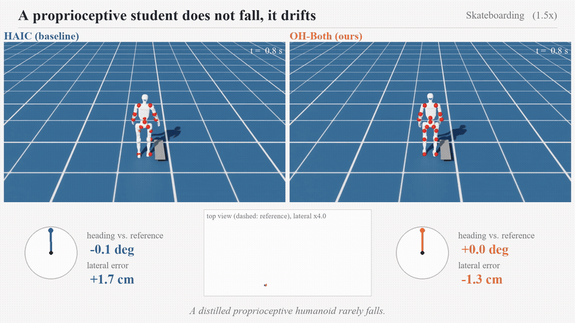
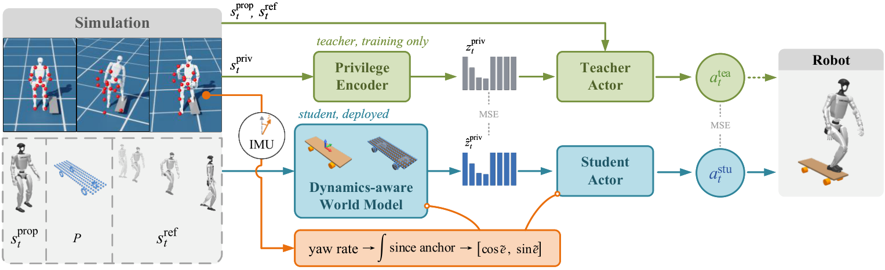
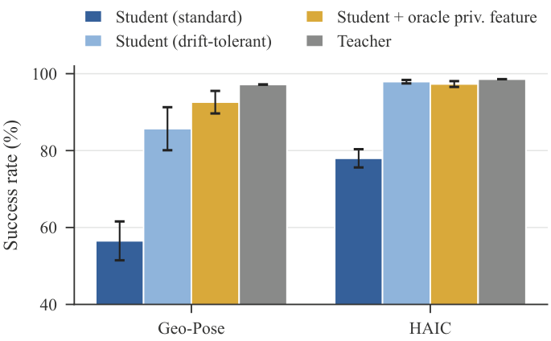
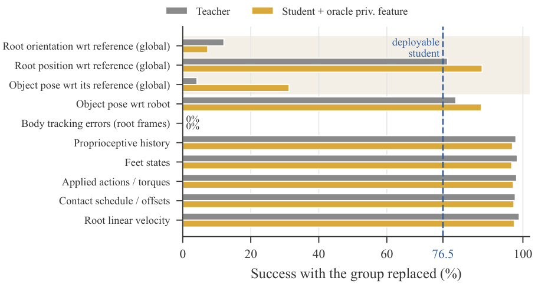
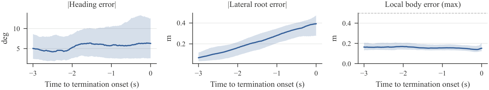
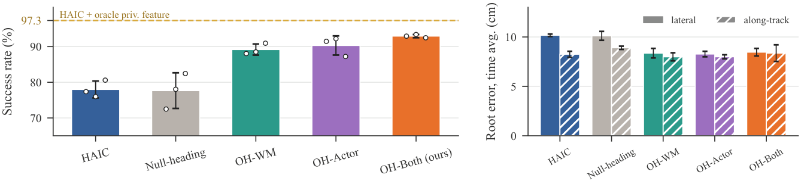
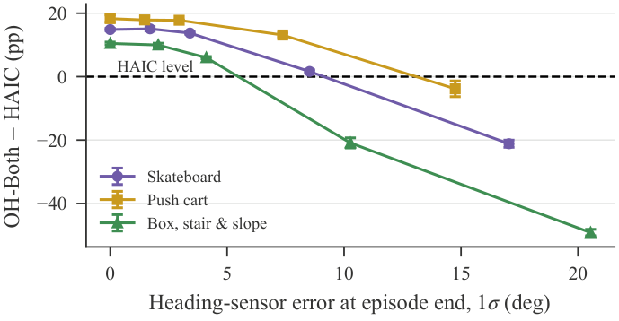

<div align="center">

# Where Do Proprioceptive Humanoids Get Lost?
### Observability-Aware Distillation for Underactuated Object Interaction

*Anonymous submission. Code release for review.*



<sub>Same episode, same seed. Left: the HAIC student drifts sideways off the reference (red spheres) and is terminated.
Right: our student with the IMU-integrated heading completes it. [1-minute video](assets/video_1min.mp4)</sub>

</div>

## TL;DR

A proprioceptive humanoid student distilled from a privileged teacher **rarely falls; it drifts**.
A diagnosis of the teacher-student gap of [HAIC](https://github.com/ldt29/HAIC) shows that the missing information is
the robot's **heading relative to the reference**, which proprioception cannot observe. One onboard signal, the
**IMU-integrated heading error**, fed to the world model and the actor with zero-initialized weights, recovers most of the
gap on three tasks.

| Task | HAIC | **Ours (OH-Both)** | Δ (paired, 3 seeds) | *p* |
|---|---|---|---|---|
| Skateboarding | 77.98 % | **92.94 %** | +14.95 pp | 0.012 |
| Pushing a cart | 71.57 % | **90.29 %** | +18.72 pp | <0.001 |
| Box over a stair and a slope | 87.96 % | **97.74 %** | +9.79 pp | 0.009 |

<sub>Success over 3 students x 3 evaluation seeds x 1024 episodes in Isaac Lab. A capacity-matched control with a constant
heading input (Null-heading) does not improve on HAIC on any task.</sub>

## Method



The teacher (green) acts from the privileged state and is used in training only. The student (blue) keeps HAIC's
dynamics-aware world model and is distilled by matching the teacher's latent feature and action. Ours (orange): the
heading error, integrated from the IMU yaw rate since the reference anchor, enters the object adapter, the privilege
adapter and the actor. The heading sensor model includes an alignment error, a gyro bias random walk and white rate noise.

## Diagnosis

| | |
|---|---|
|  |  |
| Ignoring world-frame drift, HAIC succeeds in 97.92 % instead of 77.98 %; the teacher's privileged feature alone recovers 97.31 %. | Counterfactual ablation of the teacher: removing the root orientation w.r.t. the reference drops it from 98.63 % to 12 %. |



<sub>Before a termination the heading and lateral errors grow for seconds, while the local body pose stays far from its bound.</sub>

## Results





<sub>Gain over HAIC under heading-sensor error scaled at evaluation (trained at 1x).</sub>

## Repository layout

```
overlay/                 our code, copied on top of the official HAIC checkout
  research/              pipeline: training, evaluation, diagnosis, ablation, robustness, showcase, sim-to-sim
  cfg/task/G1/haic/      *_dyn*, *_heading*, *_cr* task configs (full HAIC, heading arms, contact randomization)
patches/                 changes to six upstream HAIC files (heading input, control weighting, wheel resistance)
paper_tools/             figures, tables and the supplementary video of the paper
install.sh               official HAIC at commit e262500 + overlay + patch
```

## Installation

The upstream HAIC repository has no license file, so its code, assets and motion data are **not** redistributed here;
`install.sh` fetches them from the official repository at the commit we used.

```bash
bash install.sh            # -> ./HAIC (official e262500 + our overlay and patch)
cd HAIC
bash research/setup/setup_autodl.sh   # Isaac Sim 5.1, Isaac Lab v2.3.2, PyTorch 2.7 (cu128), conda env on the data disk
source research/setup/haic_env.sh
# read the NVIDIA Isaac Sim EULA; only if you accept it:
export OMNI_KIT_ACCEPT_EULA=YES
python -m pytest -q research/tests      # CPU tests of configs and pipeline parts
```

Tested on a single RTX 4090 (NVIDIA driver 580). With driver 595 headless training works, but RTX rendering
(only needed for `research/showcase.py`) crashed in our setup.

## Reproducing the paper

Every step is resumable; `research/run_queue.sh` runs them in order on one GPU.

```bash
bash research/run_queue.sh round1 && bash research/run_queue.sh round2   # HAIC and Geo-Pose: teacher, 3 students, diagnosis
bash research/run_queue.sh round3 && bash research/run_queue.sh round4   # heading arms (OH-WM, OH-Actor, OH-Both, Null-heading)
bash research/run_queue.sh ablate                                       # counterfactual privileged-input ablation
bash research/run_queue.sh robust                                       # heading-sensor error sweep
TASK=push_cart bash research/run_queue.sh cross && TASK=push_cart bash research/run_queue.sh cross-extra
TASK=box_stairslope bash research/run_queue.sh cross && TASK=box_stairslope bash research/run_queue.sh cross-extra
bash research/run_queue.sh cw                                           # control-weighted latent alignment
bash research/run_queue.sh cr                                           # contact-randomized fine-tuning + ONNX export
```

A student takes about 9-12 h on one RTX 4090. `python research/diagnose.py` writes `report.md` and `metrics.json`
(success under standard, drift-tolerant and oracle evaluations, tracking errors, failure causes, world-model fidelity).

**Sim-to-sim (MuJoCo).** `research/export_students.py` exports students to ONNX together with a golden Isaac rollout;
`research/sim2sim.py` evaluates them in the MuJoCo scenes of [HOIC-baseline](https://github.com/Cybercal/HOIC-baseline)
with the observation builder checked term by term against Isaac (`--check`). The evaluation protocol, fixed before the
results, is in `research/SIM2SIM_PROTOCOL.md`.
In MuJoCo the heading students track the reference better where the board can drift, but they fall more often than
HAIC during fast pushing (see the paper and the protocol file); `research/sim2sim_report.py` and
`research/sim2sim_falls.py` reproduce these numbers and the fall analysis.

**Figures, tables and video.** `paper_tools/make_figures.py` builds every figure, table and number of the paper from the
`metrics.json` files; `paper_tools/make_video.py` builds the supplementary video from the rendered showcase episodes.

## License

Our code (overlay/, patches/, paper_tools/) is released under the MIT license. HAIC, its assets and motion data, and
HOIC-baseline remain under their authors' terms.

## Acknowledgments

This work builds on [HAIC](https://github.com/ldt29/HAIC) and its MuJoCo deployment
[HOIC-baseline](https://github.com/Cybercal/HOIC-baseline), which in turn build on
[HDMI](https://github.com/LeCAR-Lab/HDMI). We thank their authors for open-sourcing their work.
